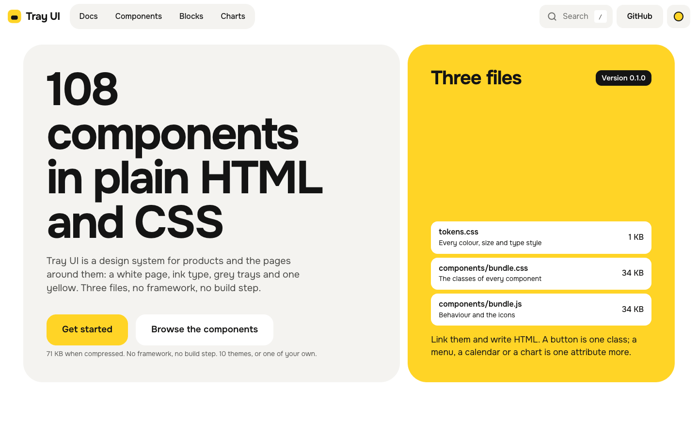

#  Tray UI

A design system for products and the pages around them, in plain HTML and CSS, with one small script for behaviour.



It is a white page, ink type in Onest, and goods set out in soft grey trays with very round corners. One yellow marks the thing to do. Nothing is outlined or shadowed: surfaces are told apart by flat fills alone.

- **108 components**, from a button to a data table: forms, navigation, overlays, data, conversation, and media (a lightbox, a video player). They also cover the frame of a product: app shell, billing, account, onboarding and public pages.
- **64 blocks**: whole screens to copy, from a dashboard and settings to a shop, a checkout, articles, a blog and a wiki, plus fifteen sidebars and sign-in pages.
- **10 templates**: whole pages of a product with realistic content, from a landing page and pricing to a dashboard, orders, an inbox, settings, billing and a first-run wizard.
- **10 themes**, six light and four dark, each measured against the system's 32 contrast rules, which pair a colour with each ground it is read on: 66 pairs. A theme maker derives your own from four colours.
- **Accessibility built in.** Keyboard support and accessible names follow [the accessibility guide](system/project/guides/3-accessibility.md), and the system answers more contrast, forced colours, print and reduced motion.
- **Icons from [Lucide](https://lucide.dev)**: 118 built into the script, and in React any other from `react-icons/lu`.
- **React**, as `trayui-react`: the same components, typed, over the same stylesheet. Its charts are drawn with [Recharts](https://recharts.github.io), with 58 examples.
- **Tailwind and Figma**: the tokens as a Tailwind 4 theme, a Tailwind 3 preset and Figma variables with a mode for each theme.
- **Three files**, about 88 KB with gzip. No framework, no build step.

## Install

Link the three files, in this order:

```html
<!doctype html>
<html lang="en" data-theme="light">
<head>
  <link rel="stylesheet" href="https://cdn.jsdelivr.net/npm/trayui@0.3.0/tokens.css">
  <link rel="stylesheet" href="https://cdn.jsdelivr.net/npm/trayui@0.3.0/components/bundle.css">
  <script src="https://cdn.jsdelivr.net/npm/trayui@0.3.0/components/bundle.js" defer></script>
</head>
```

With a bundler, install them from npm (`npm install trayui`) and import `trayui/tokens.css`, `trayui/components/bundle.css` and `trayui/components/bundle.js`. You can also copy the [`system/dist`](system/dist) folder into your project and link the same files from there. The folder also holds the font, the blocks, the templates and the tokens for Tailwind and Figma. [The Installation page](https://trayui.com/docs/installation) has the same folder as a zip.

## Write a first screen

```html
<main class="tray-container tray-section">
  <div class="tray-card tray-stack">
    <h1 class="title">Order a jar</h1>
    <div class="tray-field">
      <label class="tray-label" for="address">Delivery address</label>
      <input class="tray-input" id="address" autocomplete="street-address">
    </div>
    <button class="tray-btn" type="submit">Order a jar</button>
  </div>
</main>
```

That is a grey tray on the white page, a white field in it, and the one yellow button. Components that need a script take `data-tray`, as in `<div data-tray="tabs">`, and wire themselves. If you add markup after the page has loaded, call `TrayUI.init(root)` on it.

The files in `system/dist/blocks/` and `system/dist/templates/` open as they are: start a screen from the nearest block, or a whole page from a template.

## Add with the CLI

```sh
npx trayui init              # the three files and the font, in trayui/
npx trayui add login-01      # a block beside your pages, its links pointed at trayui/
npx trayui diff              # what you changed, and what a new release changed
npx trayui check page.html   # the markup checked against the system's rules
npx trayui kit <name>        # a paid kit from trayui.com/kits, with your licence key in TRAYUI_KEY
```

In a React app (Vite, Next.js) the same commands copy the source of components and blocks into `src/components/trayui/`, as files you own: `npx trayui add button tabs login-01`. `npx trayui update` brings them to a new release and keeps every file you changed. The items are also a registry in shadcn's format, so `npx shadcn add https://trayui.com/r/login-01.json` works too. It needs Node 18 or later and nothing else; [the CLI page](https://trayui.com/docs/cli) lists the commands. Its source is [`system/cli`](system/cli).

## React

```tsx
import { Button, Card, Field, Input } from 'trayui-react';
import 'trayui-react/styles.css';

export function OrderForm() {
  return (
    <Card title="Order a jar">
      <Field label="Delivery address">
        <Input autoComplete="street-address" />
      </Field>
      <Button type="submit">Order a jar</Button>
    </Card>
  );
}
```

Install it with `npm install trayui-react`. It needs React 18 or later; `recharts` (for the charts) and `react-icons` (for icons beyond the built-in ones) are optional. Its source is [`system/react`](system/react).

## Themes

Set `data-theme` on `<html>`, or on any element to theme only what is inside it:

```html
<html lang="en" data-theme="mint">
```

The themes are `light`, `dark`, `linen`, `mint`, `sky`, `rose`, `lilac`, `midnight`, `forest` and `espresso`.

## Browsers

The current versions of Chrome, Edge, Safari and Firefox. The stylesheet uses logical properties, `:has()`, dynamic viewport units and the native `<dialog>` and `<details>`, with no fallbacks for browsers that lack them. Motion uses `@starting-style` where the browser has it, and does without where it does not.

## Documentation

The rules of the system live in the repository:

- [the brand book](system/project/README.md);
- [the guides](system/project/guides): grounds, behaviour, accessibility, page layouts, and the lists of components and blocks;
- the guidelines and the markup of each component, in `system/project/components/<Name>/README.md`.

The documentation site, [trayui.com](https://trayui.com), has a live example of every component and block, and a playground for about half of the components. It is built from this repository, and anyone can build and run it locally; [CONTRIBUTING.md](CONTRIBUTING.md) says how.

For an AI agent, there is a skill: `SKILL.md` with the rules, every page of the docs, the components, the blocks and the charts as Markdown, and a checker the agent runs on what it writes. Install it in Claude Code with `claude plugin marketplace add https://trayui.com/skills/marketplace.json` and `claude plugin install trayui@trayui`, upload [trayui.zip](https://trayui.com/skills/trayui.zip) to claude.ai, or copy it into a project with `npx trayui skill`; [the agents page](https://trayui.com/docs/agents) says more. The site also has [llms.txt](https://trayui.com/llms.txt), an index of its Markdown pages, and `llms-full.txt`, the rules, the guides and the markup of every component in one plain file. Every page is also Markdown at its address with `.md` added.

## What is where

| Path | What |
| --- | --- |
| `system/dist/` | What you link: `tokens.css`, `components/bundle.css`, `components/bundle.js`, the font and the blocks; `tailwind/` and `figma/`, the tokens for those tools. It is built output, kept in the repository so the files can be linked and downloaded. |
| `system/src/` | What the bundle is built from: the stylesheets (`css/`), the behaviours (`js/`), the icons. |
| `system/project/` | The system as it is written: the brand book, `tokens.json`, the guides, a guide and a preview for every component, and the blocks. |
| `system/react/` | `trayui-react`: the components for React, and the charts (`trayui-react/charts`). |
| `system/cli/` | The `trayui` command (`npx trayui`) and the markup checker it and the skill run. |
| `system/skill/` | The skill for agents, as it is written: the build adds every page of the site and the checker. |
| `system/tests/` | The component tests: a module for each component (`components/<Name>.py`), the harness they run in, and what a block is excused (`blocks.py`). |
| `system/tools/` | The build, the documentation site and the checks. |

## Contributing

Issues and pull requests are welcome. [CONTRIBUTING.md](CONTRIBUTING.md) explains how to build, check and change the system, and [SECURITY.md](SECURITY.md) how to report a vulnerability.

## The names in the examples

Counter, an order desk, and Perly Farm, a snail-caviar farm that uses it, are invented. So is every person, figure, address and quote in the examples. Replace them, and never ship them.

## Licence and credits

Tray UI is released under the [MIT licence](LICENSE).

The name "Tray UI" and its logo are not covered by that licence. Use them only to refer to this project, not as the name or the mark of your own product or fork.

The system ships work by others, each under its own licence:

- **Onest**, the typeface, is by the Onest Project Authors, under the SIL Open Font License 1.1 (`system/dist/fonts/OFL.txt`).
- **The icons** are [Lucide](https://lucide.dev)'s, under the ISC licence, some of them from Feather under the MIT licence (`system/dist/components/LUCIDE-LICENSE.txt`).
- **The photographs** in the Lightbox and Video Player previews come from Wikimedia Commons, each in the public domain or under CC0 (`system/project/assets/Media/CREDITS.md`).
- **The documentation site** bundles React, Recharts and highlight.js with what they depend on, each under its own licence. The build writes their licences beside the bundles (`charts.licenses.txt`, `code.licenses.txt`).
